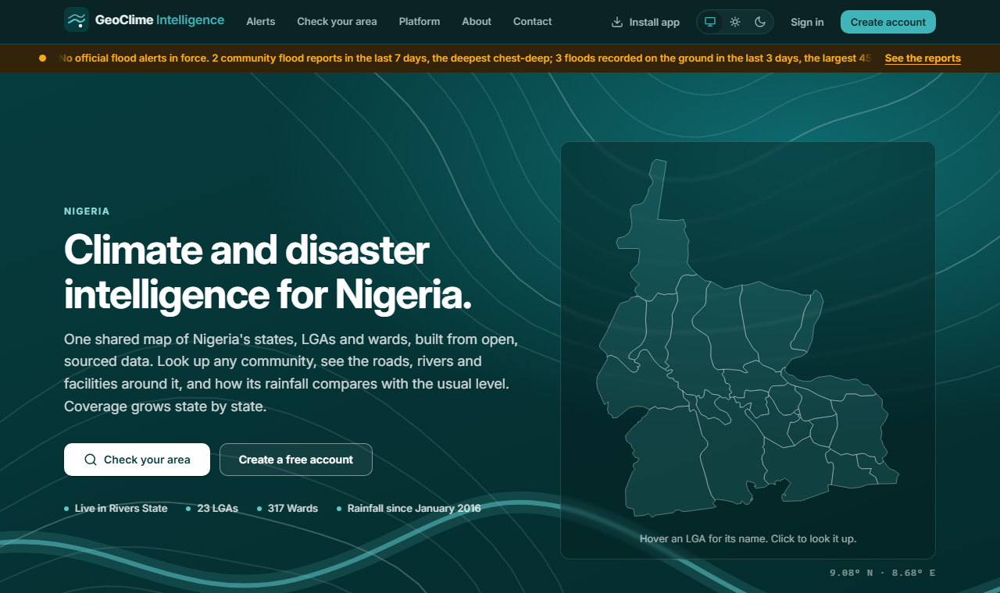
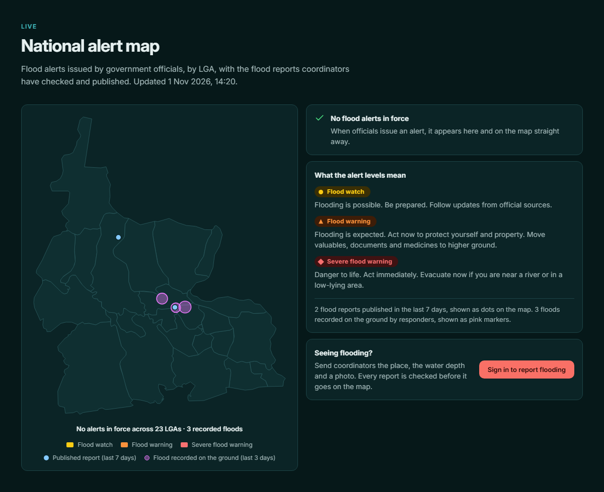
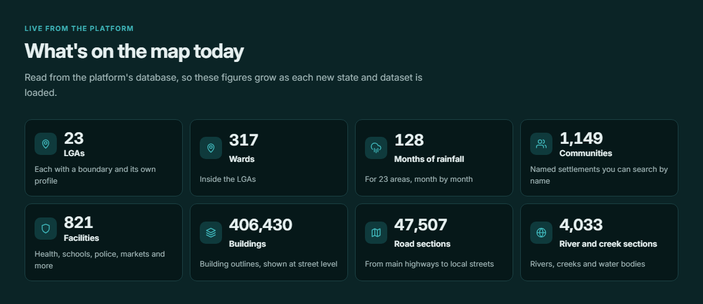
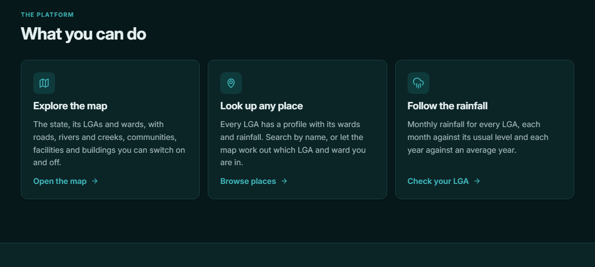
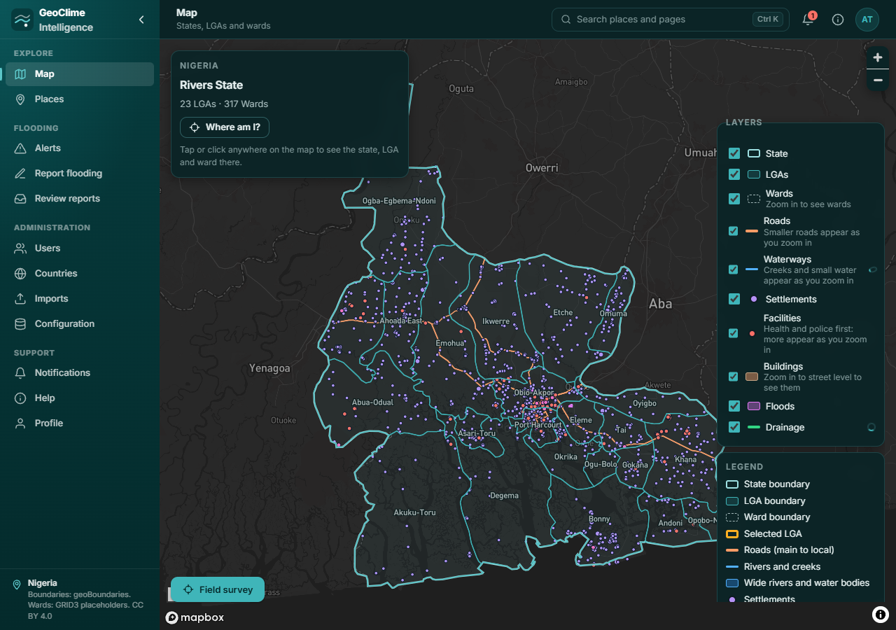
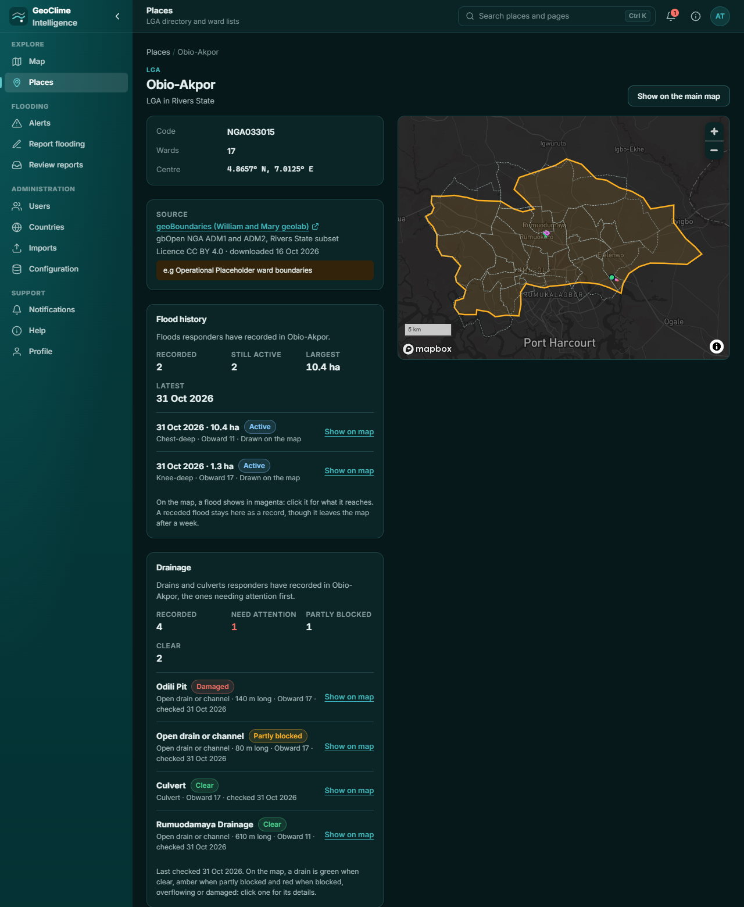
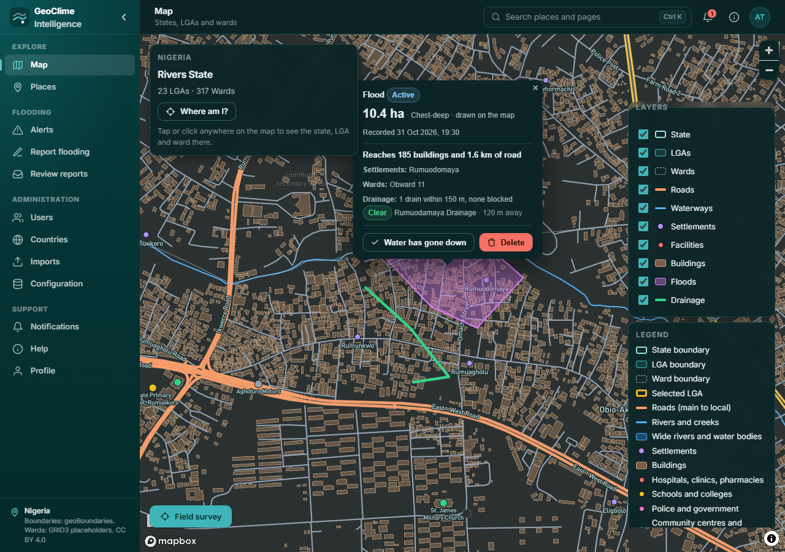
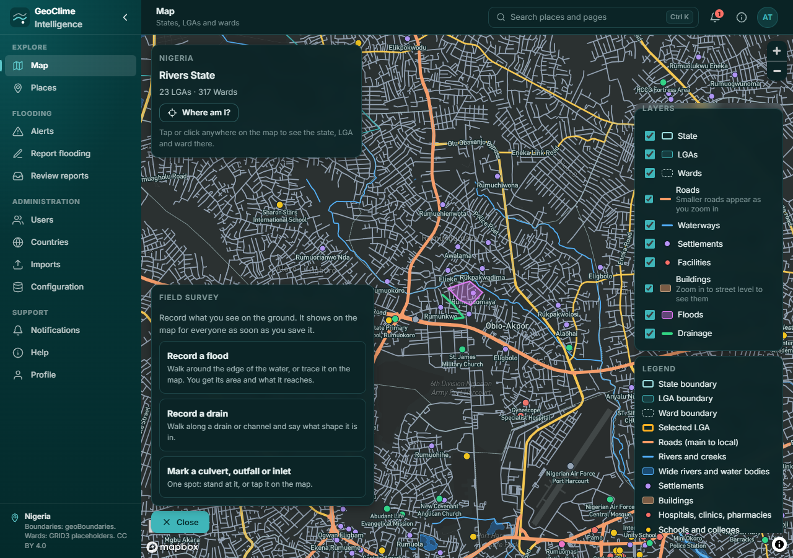
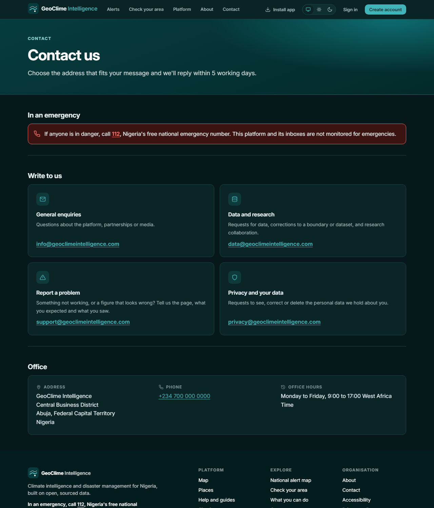

# How can our app earn money? A discussion for the group

**Date:** 1 November 2026
**What this is:** A short, plain summary of what I found about how GeoClime Intelligence could make money. Please read it, look at the proof, then write your ideas, doubts and corrections in section 13.

**Reading this on paper or as a PDF?** All the proof is inside this document: screenshots in section 1, quoted evidence in Appendix A, and every web address written out in full in Appendix B. You do not need to click anything or open any project files.

**The longer report** is in `BUSINESS_AND_MONETISATION_STRATEGY.md`.

---

## How to read the tags

Every statement of fact has a tag, so you know how much to trust it.

| Tag | Meaning |
|---|---|
| ✅ **Checked** | I looked at the page, screenshot or file myself on 1 November 2026 and it says this. The screenshot, appendix item or web address is next to it. |
| 🧮 **My calculation** | A number I worked out or assumed. It is not a fact. The working is shown. |
| 💭 **My opinion** | My judgement. There is no proof. Please disagree if you think I am wrong. |
| ❓ **Not confirmed** | I could not open the source or could not find proof. Treat it as unproven. |

Websites can change. The checks below are as of 1 November 2026.

---

## 1. What we have built

GeoClime is an app that tracks floods in Rivers State. It has a public website that anyone can open, and a sign-in area for staff and members of the public.

### What anyone can see without signing in

These are screenshots I took of our live website, https://geoclimeintelligence.vercel.app/, on 1 November 2026. You can open the same address and see the same thing. The numbers can change as data is added.

**Screenshot 1: the home page.** ✅ It says "Live in Rivers State · 23 LGAs · 317 Wards · Rainfall since January 2016". The orange bar at the top says "No official flood alerts in force. 2 community flood reports in the last 7 days, the deepest chest-deep; 3 floods recorded on the ground in the last 3 days".

**Screenshot 2: the national alert map.** ✅ It shows the three warning levels (flood watch, flood warning, severe flood warning), blue dots for public reports that were checked and published, and pink markers for floods "recorded on the ground by responders". It also says "Every report is checked before it goes on the map" and has a "Sign in to report flooding" button. It says it was updated "1 Nov 2026, 14:20".

**Screenshot 3: "What's on the map today".** ✅ 23 LGAs, 317 wards, 128 months of rainfall for 23 areas, 1,149 communities, 821 facilities, 406,430 buildings, 47,507 road sections and 4,033 river and creek sections.

🧮 "128 months" fits our notes: January 2016 to August 2026 is 10 years × 12 months + 8 months = 128.

**Screenshot 4: what a visitor can do.** ✅ Explore the map, look up any place, and follow the rainfall.

### What I saw after signing in

On 1 November 2026 I signed in to the live site with a test account that has administrator access. **I only looked.** I did not record a flood, send a report, issue a warning, or press any Save or Delete button, so I added nothing to the live data.

**Screenshot 6: the main map.** ✅ The map has these layers you can switch on and off: State, LGAs, Wards, Roads, Waterways, Settlements, Facilities, Buildings, Floods and Drainage. There is a "Field survey" button at the bottom left. The left menu has Map, Places, Alerts, Report flooding, Review reports, Users, Countries, Imports, Configuration, Notifications, Help and Profile.

**Screenshot 7: the page for one LGA (Obio-Akpor).** ✅ "Flood history" says 2 floods recorded, both still active, the largest 10.4 hectares, the latest on 31 Oct 2026. "Drainage" says 4 drains recorded: 1 needs attention (Odili Pit, damaged), 1 partly blocked, 2 clear. Below this (not in the picture) are rainfall charts for the LGA.

- ❓ Every flood and drain on this page is dated **31 October 2026**, and both floods say "Drawn on the map" (traced on the screen, not walked). That looks like test or demo data. Please tell us if it is not.
- ✅ The ward names are placeholders ("Obward 11", "Obward 17"). See section 10.

**Screenshot 8: a recorded flood on the street map.** ✅ The pink shape is the flood. The pop-up says: "10.4 ha · Chest-deep · drawn on the map · Recorded 31 Oct 2026, 19:30 · **Reaches 185 buildings and 1.6 km of road** · Settlements: Rumuodomaya · Wards: Obward 11 · Drainage: 1 drain within 150 m, none blocked". The green line is a drain.

- ❓ I did not check the building and road counts against the real streets. The building outlines come from OpenStreetMap, which may be incomplete in Rivers.
- The pop-up has "Water has gone down" and "Delete" buttons. I did not press them.

**Screenshot 9: the Field survey panel.** ✅ It offers three choices: "Record a flood" ("Walk around the edge of the water, or trace it on the map. You get its area and what it reaches."), "Record a drain" and "Mark a culvert, outfall or inlet". It also says: "It shows on the map for everyone as soon as you save it." I opened the panel but did not choose any option.

### What the app has, and where to see the proof

| What the app has | Proof |
|---|---|
| ✅ A map with 1 state, 23 LGAs, 317 wards, about 406,000 buildings and about 47,500 roads | Screenshots 1 and 3. Also the server's own answer in Appendix A10 |
| ✅ Rain figures for every LGA for each month from January 2016 to August 2026 | Screenshots 1 and 3, and Appendix A4 and A10 |
| ✅ Flood warnings at three levels (watch, warning, severe), issued only by officials | Screenshot 2 shows the three levels. No warning is in force today, so the map shows none. Appendix A1 |
| ✅ Flood reports from the public (place, water depth, photos, voice note) that are checked before they appear | Screenshot 2 ("Every report is checked before it goes on the map", with 2 published reports). When signed in I opened the report form and the review page (Appendix A11), but I did not send a report. Appendix A1 |
| ✅ A field tool: someone walks around the edge of a flood and the app works out the size and what is covered (buildings, roads, clinics). It also records drains and whether they are clear or blocked | Screenshots 2, 7, 8 and 9. Screenshot 8 shows a recorded flood that "Reaches 185 buildings and 1.6 km of road". I did **not** try the walking or tracing myself, because that would add test data to the live system. Appendices A2 and A11 |
| ❓ Notifications in the app, by email, and by push message (on the phone) | The project owner says email and push are set up. I have not seen an email or push message arrive. Appendix A3 |
| ✅ The app's own automatic tests passed when I ran them | Appendix A8 |
| ✅ The live server is running | Appendix A10 |
| ✅ How the sign-in side looks | Screenshots 6 to 9 come from a test administrator account. I only looked; I did not save, delete or send anything. ❓ I did not test the walking part with GPS. **A live demo at the meeting is still a good idea.** |

## 2. The honest truth

- ✅ **The app cannot take payment.** I searched all the app's code for payment words (paystack, flutterwave, stripe, invoice, billing, subscription, checkout) and found nothing. Details, and how a developer can repeat the search, are in Appendix A9.
- ❓ **We have no paying customers.** I found no sign of any in the code or notes. I cannot see who uses the app, so please tell me if I am wrong.
- ❓ **We don't know how many people use the app.** The user list is only visible to an admin. I had no access.
- ✅ **Flood warnings already exist for the public.** NIHSA publishes them. Example: a July 2026 alert for 17 states. Source: ThisDay, 22 July 2026 (address in Appendix B, item 1).
- ✅ **Google also gives flood forecasts for Nigeria.** Google said in May 2023 that its Flood Hub covers Nigeria and gives forecasts up to seven days ahead. Source: Gazette, citing the News Agency of Nigeria (Appendix B, item 2).
- 💭 **So selling flood warnings alone is unlikely to earn money,** and a wrong warning that looks official could get us blamed. This is my opinion.

## 3. Where the real value may be

The most useful and unusual thing we have is a **measured record of where it floods, what it covers, and which drains are blocked.** (✅ The tool exists: see the pink markers in Screenshot 2 and Appendix A2.)

- ❓ **I did not find anyone else selling this for Port Harcourt.** I cannot prove that nobody does. I only searched online for flood-data companies and found none for Port Harcourt. Please tell me if you know of any.

Why the need seems real:

- ✅ **In late September 2026, many places in Port Harcourt flooded.** The article names New GRA, Peter Odili Road, SARS Road, Borikiri, Diobu, Rumuomasi, the Trans-Amadi axis and Aba Expressway. It says schools shut, families were displaced, and a teenager died in Oyigbo. This is **one news site only**. Source: Within Nigeria, 30 Sept 2026 (Appendix B, item 3).
- ✅ **Rivers is in the top 10 high-risk states for 2026, and Port Harcourt is number 2 for city flooding.** This comes from a flood guide that says it uses NIHSA's yearly flood outlook. I have not seen NIHSA's own outlook, and who published the guide is not clear. Source: 2026 Flood Guide for Rivers State, a PDF (Appendix B, item 4).
- ✅ **Flooding in Rivers has three causes, not one.** The same guide says rivers overflowing, ocean tides pushing water inland, and poor drainage. It adds that in Port Harcourt "poor urban drainage compounds river and tidal flooding" and that the most useful action is "keeping drains clear of refuse".
  - **Correction:** an earlier draft of this document said most flooding comes from blocked drains. That was wrong. Drains are one cause we can help with, not the only one.
- ✅ **Lagos got a flood insurance policy in 2026** that can pay up to USD 7.5 million and covers up to 4 million people. Sources: Insurance Edge, 27 March 2026, and AXA Climate, 26 March 2026 (Appendix B, items 5 and 6).
  - 💭 This shows money is starting to move into flood protection in Nigeria. It does **not** prove anyone will pay for local flood data like ours.
- ✅ **A big oil and gas company has lost operations to flooding before.** Nigeria LNG declared "force majeure" (it could not meet its contracts) after floods in October 2022. Source: Associated Press via Fox News (Appendix B, item 7).

## 4. Who might pay us

The order below is **💭 my opinion** from what I read. Nobody has been asked yet.

| Order | Who | Why they might pay | How fast (💭) | Proof for the "why" |
|---|---|---|---|---|
| 1 | Schools, hospitals, banks, estates and companies in flood areas of Port Harcourt | Floods close them and damage property | Weeks | Section 3: the September 2026 flooding report |
| 2 | LGAs and state agencies | They deal with floods and drains | Slow, and government may pay late (❓ no current figure found) | A Rivers State official said the state had started setting up a State Emergency Management Agency. The article names the state's "sole administrator", so it is probably from 2025, and I don't know today's status. Source: BusinessDay (Appendix B, item 8) |
| 3 | NGOs and the Red Cross | They fund flood preparation | A few months | ✅ The Red Cross set aside CHF 80,000 in July 2026 for flood preparation, but **in eight other states** (Adamawa, Akwa Ibom, Bauchi, Benue, Cross River, Edo, Lagos, Plateau), **not Rivers.** So money exists, but not yet here. Source: IFRC document, a PDF (Appendix B, item 9) |
| 4 | Oil and gas companies | They have money and flood risk | Slow | Section 3: the 2022 force majeure |
| 5 | Insurance companies | They may want proof of what flooded | Slow | Section 3: the Lagos policy. 💭 That they want our data is my guess |
| 6 | Ordinary people | They care, but 💭 will pay very little | Not a good way to earn | None. We should test it |

## 5. What we could sell

**Idea in one line:** start by selling a service that uses our app, not the app itself. That is the fastest way to get the first money.

All prices are **🧮 guesses to test.** They are not proven. They are set so the work pays for itself (see section 7), not copied from a competitor.

| What | For whom | Price (guess) | What they get |
|---|---|---|---|
| **Free flood sheet** | People we want as customers | Free | A one-page picture of their address from our map: roads, waterways, drains and facilities nearby, plus any floods or drains our team has recorded close by. Today very few are recorded, so this page will often say "nothing recorded yet" |
| **Site Flood Check** | One school, hospital, bank or building | **₦250,000** | A visit, a check of drains and access roads, and a PDF listing what to fix first |
| **Estate or campus check** | A bigger site | **₦600,000 to ₦1,500,000** | The same, plus a drain-by-drain list |
| **Rainy-season plan ("Site Watch")** | The same customers, after the check | **₦40,000 a month**, or **₦400,000 a year if paid upfront** (about 17% cheaper) | Flood updates for their street, messages to up to 20 people, a report after each flood. **Needs email, push or text messages working first** |
| **Free trial for one LGA** | One LGA that agrees in writing | Free for 90 days | We list the main drains and train their staff |
| **LGA yearly plan** | That LGA after the trial | **₦2.5 million a year** plus ₦1.5 million to set up and train | The app, support and reports |

- ✅ **Text messages (SMS) are not built.** ❓ The project owner says email and push notifications are set up. They reach people who have an account and have chosen their home LGA, when an official alert is issued in the app for that LGA (Appendix A3). Custom messages such as "flood reported near your school", and messages to people without the app, would be sent by hand (for example by WhatsApp) until we build text messages. We should build them only after the first customers say yes.
- ❓ I have not checked what people near us already pay for similar work (for example local engineers or GIS consultants). **Please help me find 3 prices** before we fix ours.

### How each offer works, in plain words

The table above says what the customer gets. This part explains **how we would make it**, step by step. Nothing here needs new software, except where it says so.

**Three things sit behind everything we sell:**

1. **Our map and data in the app** (what the screenshots in section 1 show).
2. **A person on the ground:** our field person, who visits the site.
3. **Our write-up:** a PDF report, a phone call, or short messages.

The customer does **not** need to use the app. They get the write-up. The app is our tool behind the scenes, like a mechanic's workshop: the customer sees the repaired car, not the tools.

**Words you may not know**

| Word | What it means |
|---|---|
| LGA | Local Government Area. Rivers State has 23. A ward is a smaller area inside an LGA |
| Drain or channel | A ditch or pipe that carries rain water away from streets and buildings |
| Culvert | A pipe or tunnel that lets water pass under a road |
| Outfall and inlet | An outfall is where a drain empties into a river or creek. An inlet is where water enters a drain |
| Blocked drain | A drain where rubbish or mud stops the water. Water then stands in the street |
| Recorded flood | A flood that someone has marked on our map, with its size and how deep the water was |
| What a flood "reaches" | The buildings, road length, clinics and schools inside the flood's outline. The app counts them for us |
| Rainfall "against average" | Whether a month was wetter or drier than the same month in other years. Our app has this for every LGA |
| Official alert | A warning from NIHSA, NEMA or the state. We can pass these on. We do not issue them ourselves |

### A worked example: a private school in Obio-Akpor

This is an **imagined example, not a real customer.** The times are 🧮 my guesses.

| When | What happens | Who does it |
|---|---|---|
| Day 1 | **Free flood sheet.** We search the school's address in the app, look at the map around it (roads, a creek or waterway, drains, clinics nearby), take a screenshot and add a few notes. About 30 minutes | Us |
| Day 3 | The owner says yes and pays half the fee upfront | School and us |
| Day 5 | **Preparation, about half a day.** We look at the map again, read the LGA's flood history and look at the rainfall chart to see which months are wettest | Us |
| Day 7 | **Site visit, about a day.** Our field person walks the school grounds and the access road, takes photos, and notes where water stands. They look at the drains and culverts nearby. For each drain, they use the app's "Record a drain": they walk along it, say whether it is clear, partly blocked, blocked or damaged, and the app plots it on the map and works out its length. They also ask staff and neighbours when it last flooded and how deep | Field person |
| Day 9 | **Writing the report, about half a day.** We write the PDF by hand (see the list below) | Us |
| Day 10 | We give the school the PDF and hold a **30-minute call** to go through it | Us |
| About day 40 | **Follow-up call.** What was fixed? If the school cleared a drain, we update it in the app with "I checked it" and the drain turns from red to green | Us |
| February to April | We offer the school the rainy-season plan (Site Watch) | Us |

**What the school gets for ₦250,000:** the PDF and two calls. That is all.

**What is in the PDF:**

1. A one-page summary: the biggest risks and the top 3 things to fix first.
2. A map of the school and the nearby drains, coloured the way the app colours them: green for clear, amber for partly blocked, red for blocked or damaged.
3. A drain-by-drain list: name, type, length, condition and the date we checked it.
4. Flood history near the school: what staff told us and what is recorded in the app.
5. Rainfall: which months are wettest. Our own data shows about 420 mm in July against about 48 mm in December (Appendix A4).
6. Photos with short notes.
7. An action list: who should do what. For example, "the school clears its own drain", or "the blocked culvert under the public road belongs to the LGA, so write to its works department".
8. A short list of what we could **not** check.

**What the school does not get:** an engineer's design, a promise that it will not flood, or a flood forecast.

### Offer by offer: what they get, and how we make it

| Offer | What the customer receives | How we make it | Can we do it today? |
|---|---|---|---|
| **Free flood sheet** | One page: a picture of their address | We search the address in the app, take a screenshot and add notes. About 30 minutes | ✅ Yes, by hand. It is only as good as the data: few floods and drains are recorded so far |
| **Site Flood Check** | A PDF report, a 30-minute call, and a follow-up call | The steps in the table above | ✅ Yes. The app gives us the map and the drain recording. ✅ The app cannot make a PDF (I searched its code), so we write the report ourselves |
| **Estate or campus check** | The same, covering many drains | The app's "Record a drain" measures each drain our field person walks and plots it with its condition. The drain list is the main product | ✅ Yes. It takes longer, so it costs more |
| **Rainy-season plan (Site Watch)** | Short flood status messages in the rainy season, a report after a nearby flood, two check-in calls, and quick review of the customer's own reports | See "Site Watch in detail" below | ⚠️ Partly. Email and push reach people who have an account in the app. Custom messages, and people without the app, would be sent by hand (for example by WhatsApp) at first |
| **Free trial for one LGA** | Training, a list of the main drains with their condition, and use of the app | We train about 10 officers for half a day. They record drains and floods with their phones. The LGA page already lists drains "needing attention first" (Screenshot 7), which is a to-do list for the works department. They can also check public reports and issue alerts | ✅ Yes, the app already does this. It needs officers with smartphones. Their records show to every signed-in user (Screenshot 9) |
| **LGA yearly plan** | Continued use, support, and a monthly summary | We keep supporting them and send a monthly note: floods recorded, drains needing attention, rainfall against average | After the trial |

### Site Watch in detail

This is the offer that is hardest to picture, so here it is slowly.

**What it is:** a flood **status** service in the rainy season. It is **not** a forecast.

**Three kinds of message we would send:**

1. **Official warnings.** When NIHSA, NEMA or the state issue an alert that covers the customer's LGA, we send it on in a short message. We do not create official warnings ourselves.
2. **What is happening near you.** Our alert map shows public reports that we have checked, and floods our field people have recorded. If something is reported close to the customer, we message them, for example: "Flood reported near [road name], chest-deep."
3. **After a flood nearby.** A short report: what flooded around you, and which drains were involved.

**What we cannot do:** predict a flood. Our app only has **monthly** rainfall figures, not daily rain or forecasts. Our own notes say: "It isn't real-time warning. A monthly total hides the one-day downpour that floods a street in Port Harcourt." (Appendix A4.) So we must **never promise** "we will warn you before it floods".

**How the messages would be sent:** the app's own email and push messages (❓ the owner says they are set up) go to people who have an account and chose their home LGA, when an official alert is issued in the app for that LGA (Appendix A3). Our custom messages, such as "flood reported near your school", are not automatic. At first we would send those by hand, to up to 20 phone numbers per customer (staff, security, parents), for example by WhatsApp. That works for about a dozen customers. For more, we would build text messages or automatic messages.

**Who does the watching:** someone on our team would have to check the alert map and official notices every day in the rainy season. 💭 That is roughly May to October. That time is a real cost. In section 7 I allowed only 1 hour a month per customer, which may be too low while messages are sent by hand.

**"Quick review of the customer's own reports":** if the customer's staff send a flood report through the app, we check theirs first so it appears on the map sooner.

### Things to be careful about

- ❓ **We may not have engineers.** The report would be a practical check, not an engineering study, and we must say so on every report. Please tell us if anyone in the group has drainage or civil engineering experience.
- ✅ **What we record in the app is not private.** It shows to every signed-in user (Screenshot 9). So we would ask each customer's permission before recording their drains. Otherwise we would keep the findings in the PDF only.
- ✅ **Very little is recorded so far.** The first paid checks would add the first real records. Until then the free flood sheet often has little to show.
- ❓ **The building and road counts have not been checked against real streets.** They come from OpenStreetMap, which may be incomplete.
- 🧮 **Times and prices are guesses.** We should time our first three checks and correct them.

## 6. What we should not do now (💭 my opinion)

- No ads in the app. They could make people trust us less.
- No paid app for ordinary people.
- No big new features (AI, sensors, a marketplace, other states) until someone has paid.

## 7. The money in simple numbers

**Think of a small shop that sells bread.** To know if the shop makes money, you ask two questions:

1. How much do I keep from each loaf, after paying for flour and the baker's time?
2. How much is the rent each month, even on a day when I sell nothing?

Then you work out how many loaves you must sell to pay the rent. We do the same for our app. Our "loaf" is one **Site Flood Check**.

**Everything in this section is 🧮 my guess or my calculation.** Please correct the numbers with real quotes.

### Step 1: How much we keep from one Site Flood Check

We charge **₦250,000**. Doing the check costs us money too:

| What we spend on one check (my guess) | ₦ |
|---|---|
| Our field person, 1 day | 20,000 |
| Transport and phone data | 10,000 |
| Writing the report, half a day | 20,000 |
| **Total we spend** | **50,000** |

**What we keep from one check:** ₦250,000 − ₦50,000 = **₦200,000**.

- Customers will pay offline (bank transfer, or in person against an invoice), so I assume **no payment fee** for now.
- ❓ The three amounts above are **my guesses**. I have not researched what these cost in Port Harcourt.

### Step 2: What we pay every month, even if we sell nothing

This is our "rent". I estimate about **₦380,000 a month**:

| What it is | ₦ a month (my guess) |
|---|---|
| Hosting and services: the server, the database, maps, storage, email and monitoring | about 180,000 |
| One part-time helper (see "Who is the helper?" below) | about 200,000 |
| **Total** | **about 380,000** |

- Where the ₦180,000 comes from: I guessed about **$135 a month** ($25 server + $50 database + $40 maps, storage and email + $20 monitoring) and multiplied by ₦1,334 per dollar.
- ✅ The exchange rate was about ₦1,333.64 per dollar on 21 October 2026. Source: Techeconomy (Appendix B, item 10).
- ❓ **I could not confirm the hosting and database prices** from the companies' own pages. Please get real quotes (Render for the server, Aiven for the database).
- ❓ The ₦200,000 for a helper is also a guess. I did not research what this job pays in Port Harcourt.

**Who is the helper?**

The helper is **not a named person.** It is a cost I put in so the numbers are not too optimistic. It stands for one part-time person who looks after the work around the checks. 💭 This is what I imagine they do:

- Answer calls and messages from customers and people who may become customers.
- Book the site visits.
- Send invoices and confirm that payments have arrived.
- Follow up with each customer after a check (the follow-up call about 40 days later).
- Check the public flood reports before they appear on the map. Every report must be checked first (Appendix A1).
- In the rainy season, check the alert map and official notices every day, and send the Site Watch messages by hand (see section 5).
- Keep our records tidy: drains we checked, customers, and what each customer was promised.

**A warning about double counting.** Step 1 already includes ₦20,000 for our field person's day on each check. If the helper is also the person who visits the sites, I have counted some of the same work twice. In that case the monthly "rent" would be about ₦180,000, not ₦380,000, and **1 check a month** would break even instead of 2.

**It could also be one of us.** If group members do this work themselves, at least at the start, the ₦200,000 disappears for now. The cost only becomes real once there are enough customers (about a dozen Site Watch customers) that the daily watching needs someone's regular time.

**The group needs to decide:** who will do this work, and will they be paid?

### Step 3: How many checks must we sell to cover the rent?

Each check leaves us ₦200,000. The rent is ₦380,000.

| Checks sold in a month | What we keep | Compared with the rent of ₦380,000 |
|---|---|---|
| 1 | ₦200,000 | Not enough. We lose ₦180,000 |
| **2** | **₦400,000** | **The rent is paid, with ₦20,000 to spare** |
| 3 | ₦600,000 | ₦220,000 profit |

**So we need about 2 checks every month** just to pay the rent. The point where we neither lose nor make money has a name, **"break-even"**. For us, break-even is about 2 checks a month. (The exact sum is 380,000 ÷ 200,000 = 1.9, which we round up to 2.)

If we keep costs very low (no paid helper, cheap hosting), the rent drops to about ₦56,000 a month, and one check every 3 to 4 months would cover it.

### What happens to the ₦200,000?

The ₦200,000 we keep from each check is **not all profit.** Follow the money:

1. The customer pays ₦250,000.
2. ₦50,000 goes straight out to deliver that check (field person, transport, report).
3. ₦200,000 stays with us. Its first job is to help pay the monthly "rent" of about ₦380,000.
4. Whatever is left after the rent is **profit**.

**A month with 3 checks:**

| | ₦ |
|---|---|
| Money in (3 × 250,000) | 750,000 |
| Delivery costs (3 × 50,000) | −150,000 |
| Rent for the month | −380,000 |
| **Left over (profit)** | **220,000** |

**What the profit is for is the group's decision.** It could pay group members, build a cushion for slow months, improve the app (PDF reports, text messages, better ward names), or buy equipment such as phones for the field person.

**What is not in these numbers:** tax (an accountant must tell us what applies), any pay for ourselves beyond the helper, and one-off set-up costs of roughly ₦0.5 million to ₦1 million for company registration, legal review of our terms and privacy pages, and data-protection registration (🧮 my guess). So the real profit will be a bit lower than the table shows.

### Step 4: What the first year could look like

The idea is simple. Over 12 months we **add up the money that comes in**, **take away what we spend**, and see **what is left**.

We do not know how many customers we will get. So here are three stories: **a few customers**, **some customers**, and **many customers**. All the numbers are guesses.

#### Story 1: Some customers (the middle story)

In the year we sell 24 Site Flood Checks and 12 rainy-season plans.

**Money coming in**

| | ₦ |
|---|---|
| 24 checks × ₦250,000 | 6,000,000 |
| 12 rainy-season plans × ₦400,000 | 4,800,000 |
| **Total coming in** | **10,800,000** |

**Money going out**

| | ₦ |
|---|---|
| Doing the work (about ₦50,000 for each check and about ₦48,000 for each plan) | 1,770,000 |
| Our "rent" for 12 months (₦380,000 × 12) | 4,560,000 |
| **Total going out** | **6,330,000** |

**What is left:** ₦10,800,000 − ₦6,330,000 = about **₦4.5 million**.

#### Story 2: A few customers

We sell only 8 checks and 4 plans.

- Money coming in: (8 × ₦250,000) + (4 × ₦400,000) = ₦2,000,000 + ₦1,600,000 = **₦3.6 million**.
- Doing the work costs about ₦0.6 million.
- If we pay the full "rent" of ₦4.56 million, we are **₦1.55 million short**. We lose money.
- If we keep the rent very low (no paid helper, cheap hosting, about ₦0.67 million for the year), we keep about **₦2.3 million**.

**The lesson:** if few customers come, we must keep our costs low, or we lose money.

#### Story 3: Many customers

We sell 40 checks, 30 rainy-season plans, 2 LGAs pay, and we win one bigger project.

- Money coming in: ₦10 million (checks) + ₦12 million (plans) + ₦8 million (2 LGAs at ₦4 million each) + ₦6 million (the bigger project) = **₦36 million**.
- Doing the work costs about ₦6 million.
- With this many customers we would need more staff, so the "rent" for the year rises to about ₦9.6 million.
- What is left: about **₦20.4 million**.

#### The three stories side by side

| Story | Money coming in | What is left |
|---|---|---|
| A few customers | ₦3.6 million | A loss of ₦1.55 million, or about ₦2.3 million if costs are very low |
| Some customers | ₦10.8 million | About ₦4.5 million |
| Many customers | ₦36 million | About ₦20.4 million |

### What this means in plain words

- **The one number to remember: about 2 checks a month** pays our running costs.
- In the middle case we would be left with about **₦4.5 million** after the first year. That is about USD 3,350 (at ₦1,334 per dollar).
- So this is a **small business in its first year, not a big one yet.** The real purpose of year one is to prove that people will pay, and to build up our records of floods and drains. Bigger money (whole LGAs, insurance companies, other states) can come later, once we have that proof.
- If we get **few customers** and carry full costs, we lose money. That is why the plan says to keep costs low at the start.

## 8. Why now?

- ✅ **Our own rain data shows the dry months.** Average monthly rain across the LGAs is about 48 mm in December and 36 mm in January, against 420 mm in July. This comes from the rain data loaded in the app, 2016 to 2026. The full month-by-month table is in Appendix A4.
- ✅ **The flood guide says early rains come April to June and the heavy season is July to September.** Source: Rivers flood guide (Appendix B, item 4).
- 💭 **So November to March is the time to check drains and prepare,** and the right time to sell checks. This is my reasoning.
- 💭 **December is slow for business because of the holidays,** so I suggest agreeing deals before about 18 December and signing in January. This is general knowledge, not researched.

## 9. Our plan for the next 90 days (💭 my suggestion)

**First 2 weeks**
- Put real phone numbers and email addresses on the site.
  - ✅ The live site shows placeholders. Screenshot 5 below is our Contact page: it lists info@, data@, support@ and privacy@ at geoclimeintelligence.com, the phone "+234 700 000 0000" and an address in "Central Business District". The project's own note says these are stand-ins (Appendix A7).
  - ✅ **That domain does not exist,** so no one can email those addresses. Appendix B, item 11 is a web address that answers `"Status":3`, which means "no such domain". We need to register a domain and set up real email.

- Move the app off the free hosting that goes to sleep. ✅ Our setup file says "plan: free", and our notes say a free server goes to sleep (Appendix A5).
- Use a separate database for the live app. ✅ Our notes say the live app and testing share one database (Appendix A5).
- Make a list of 150 schools, estates, hospitals and companies. Choose the best 25.
- Make 5 free flood sheets and a sample PDF report.

**Weeks 3 to 4**
- Talk to at least 15 of them. Try three prices to see where people say no.
- Set up simple invoicing: we send an invoice, and the customer pays by bank transfer or in person.
- Talk to one LGA and one NGO about a free trial.

**Month 2 (December)**
- Sign 2 first customers at half price, in return for a short testimonial.
- Do their checks and record how long each one really takes.
- **Day 60 check-in.** About 60 days after we start, we stop and ask one question: is this working? We then choose one of three things: carry on, change direction, or stop. The table below explains how we choose.

**Month 3 (January)**
- Offer the rainy-season plan to the first customers.
- Add PDF download and make recording work without network. ✅ Both are not built yet (Appendix A2, "Not built yet").
- Prepare to sell before the rains start.

**How we decide at day 60 (💭 my suggestion)**

| What we see | What we do |
|---|---|
| At least 3 people pay a deposit, or 5 sign a note stating the price | Carry on and build the extra features |
| People like it but nobody pays | Try NGOs and the LGA route for 30 more days |
| Fewer than 3 of 25 people have any money for this | Stop selling and look for a grant instead |

**Why we need a day 60.** Everything in this plan is a guess, and nobody has been asked to pay yet. If we never pause to check, we could spend months and money on something that is not working. Day 60 is the date we look at the real results and decide. We judge by whether people actually **paid or committed**, not by compliments.

**An example.** We start on 1 November and talk to 25 schools, estates and clinics. By about 30 December, if 3 of them have paid us a deposit, we carry on. If all 25 said "nice idea" but nobody paid, we change direction.

**What is a "signed note stating the price"?** It is a short note, often called a "letter of intent", in which a customer says in writing that they **intend to buy** from us at a price we have both seen, without paying yet. For example: "I, [name], [job title] at [school or company], intend to buy a Site Flood Check for ₦250,000 for [address], to be done in [month]. Signed [date]." It can be a signed paper, or an email or WhatsApp message from the decision-maker that says the same thing. It should include their name, their organisation, the service, the price and roughly when.

- It counts because saying "nice idea" costs nothing, but writing "I will buy this at ₦250,000" is a real commitment, and it tests our price.
- We ask for 5 notes but only 3 deposits because a deposit means money has already moved, which is stronger proof. A note is not binding, and some people sign to be polite and never pay.
- It is **not** payment, and nobody can be forced to buy because of it.

The numbers (3 deposits, 5 signed notes, 3 of 25) are 💭 my suggestion. The group can change them.

## 10. What could go wrong

- **Nobody pays.** We find out early by testing with real people before building more.
- **Customers leave after the rainy season.** We ask for a full year paid upfront.
- **A wrong warning causes harm.** 💭 Only people with proper permission should send warnings. We should try to get a written agreement with NIHSA, NEMA or the state.
- **The map data is not perfect.**
  - ✅ Our ward lines are "placeholders", and on 30 October 2026, 28 of the 317 wards had their middle point outside the LGA they belong to (Appendix A6).
  - ✅ The ward **names** are placeholders too. The live pages show "Obward 1", "Obward 11", "Obward 17" and so on, not real ward names (Screenshots 7 and 8). A school or estate in Port Harcourt will not recognise "Obward 11", so reports will need to name the real street or community.
  - ❓ We do not know how complete the building data is. It comes from OpenStreetMap, and I could not check how many buildings are missing in Rivers.
- **Our customers' data would not be private.** ✅ The Field survey panel says what you save "shows on the map for everyone as soon as you save it" (Screenshot 9). So today we cannot give a customer a private record of their site. That is why the first offer is a PDF report, not access to the app.
- **Government pays late or not at all.** 💭 We should treat them as a free trial and reference, not main income.
- **The app goes down in a storm.** We must pay for hosting that stays on (section 9).
- **Too few of us.** One person doing field visits, selling and fixing the app is not enough.
- **Rules we must check before selling widely.**
  - ✅ **Map data licence.** OpenStreetMap data needs credit, and "if you alter or build upon our data, you may distribute the result only under the same license". Selling reports should be fine. Selling copies of the data may not be. We should ask a lawyer. Source: OpenStreetMap copyright page (Appendix B, item 12).
  - ✅ **Rain data.** The CHIRPS rain data is registered as public domain. Source: Digital Earth Africa (Appendix B, item 13).
  - ✅ **Google Earth Engine** (a tool our notes suggest for getting rain data) has a free "noncommercial" level, and commercial use is charged separately. If we earn money, we should expect to count as commercial. Source: Google's page (Appendix B, item 14).
  - ✅ **Data protection registration.** Organisations that handle a lot of personal data must register with the Nigeria Data Protection Commission. The fees reported are ₦250,000, ₦100,000 or ₦10,000 depending on the level. We should check which level, if any, applies to us. Source: NAN News (Appendix B, item 15).
  - ❓ Company registration and tax papers. I don't know our status. Please tell me.

## 11. What we don't know yet (please help)

1. How many people actually use the app now?
2. Are the recent flood records in the app real, or were they tests? (The 3 floods and 2 reports in Screenshot 2 were created on 30 and 31 October. In Screenshot 7 every flood and drain is dated 31 October, and the floods were "drawn on the map", not walked.)
3. Is GeoClime a registered company? Which domain will we buy for real email, now that geoclimeintelligence.com does not exist?
4. Who can do field visits, and who can do the selling?
5. Do any of us know people at an LGA, SEMA, NEMA, an estate, a school, a hospital or a company in Port Harcourt?
6. Does any of us already have an agreement, grant or promise from anyone?
7. How much money and time can we put in over the next 3 months?

## 12. Decisions for the group

Please tick or write your answer.

- [ ] Do we agree to **start with paid Site Flood Checks** and not build new features yet?
- [ ] Do we agree to **offer one LGA a free trial** for a written agreement?
- [ ] Do we agree to **spend a little** (hosting, domain, registration) before we sell?
- [ ] Who will **lead the selling**? ______________
- [ ] Who will **lead the field work**? ______________
- [ ] Who will **handle money, invoices and registration**? ______________
- [ ] Who will be the **helper** in section 7 (customers, bookings, invoices, daily watching in the rainy season), and will they be paid? ______________
- [ ] Do we agree with the **day 60 decision rule** in section 9?

## 13. Your suggestions

Please add a row. Even a short idea or a doubt helps.

| Name | Section | Your suggestion, question or doubt | Why |
|---|---|---|---|
| | | | |
| | | | |
| | | | |
| | | | |
| | | | |

**Things I would especially like your help with**

- Is ₦250,000 for a site check too high, too low, or about right for people you know?
- Which schools, estates, hospitals or companies would you contact first?
- Is there any group (an estate association, a chamber of commerce, a church, a market group) we should speak to?
- Is anything in this plan wrong or unrealistic?
- Can anyone confirm real prices for hosting, the database, and field staff?
- Does anyone have drainage or civil engineering experience, or know someone who does?
- Is the worked example in section 5 how you would expect a school or estate to buy this? What would you change?

---

## Things I could not confirm

So you do not have to hunt for them, these are the points where I have **no proof** or could not open the source:

1. Hosting and database prices (section 7).
2. Day rates for field staff and report writing (section 7).
3. The size of our competition in Port Harcourt (section 3).
4. Whether anyone will pay ₦250,000 for a site check (section 5).
5. A reported UNDP plan to extend the Lagos flood insurance to other states. The page was blocked when I tried to open it.
6. The Rivers State government's current plan for a State Emergency Management Agency (section 4).
7. How the walking part of the field tool works in the field with GPS. I opened the Field survey panel but did not use it, so as not to add test data to the live system.
8. Several pages I only saw as search results and could not open: an EU grant of EUR 70,000 for flood preparation in Nigeria, a Radio Nigeria item on the Port Harcourt mayor and building on waterways, and a report on the 2012 floods cutting oil output. I do not use them above.
9. Email and push messages actually arriving. The project owner says they are set up. I have not seen one arrive.

---

# Appendix A: Evidence from our own project

This appendix is for readers who cannot open our project files. Each item gives the file it came from and a short quote or result, copied as it appears. Anyone with access to the project folder can find the same text in the file named.

### A1. Warnings and public flood reports
*From the project note `docs/flood-alerts-and-reports.md`.*

- "Government officials and administrators issue alerts at three levels": **Flood watch** ("Flooding is possible. Be prepared."), **Flood warning** ("Flooding is expected. Act now.") and **Severe flood warning** ("Danger to life. Act immediately.").
- "Any signed-in user can send one:" the GPS position; "the water depth: ankle, knee, waist, chest or impassable"; a description; "up to 3 photos and an optional voice note of up to 60 seconds."
- "Every report starts *Waiting for review*. Emergency responders, government officials and administrators review the reports in their region, then publish or reject them."

### A2. The field tool and the drain record
*From the project note `docs/field-survey.md`.*

- "This lets a responder **record the flood's extent on the map while standing in it**, and record **the drains that should have carried the water away**."
- For a flood, the result is: "Its area and perimeter, measured on the server, and **what it reaches**: buildings, road length, facilities, settlements, wards, and the drains beside it."
- For a drain, the form asks "what shape it is in (clear, partly blocked, blocked, overflowing, damaged)". Walking along a drain gives "A line on the map, coloured by condition, with its length."
- Later, opening a drain shows "**I checked it**: pick the condition now and save, which moves *last checked* to today." "A drain that was blocked in March and cleared in April reads as cleared, and the map shows it."
- **Not built yet** (from the same note): "exporting extents as GeoJSON or KML for planners; ... a queue that saves recordings made with no signal and sends them when it returns".
- **A warning in the same note:** "The PostGIS SQL is not run by the test suite. Apply the migration and try a flood and a drain against a real database before relying on it, and check an area against a figure you know (walk a football pitch: about 0.7 ha)." In plain words: nobody has yet shown that its measurements are correct by checking against a known area.
- ✅ I looked at the finished feature in the live app (Screenshots 7, 8 and 9). I did not use it to record anything.

### A3. Notifications
*From the project note `docs/notifications.md`.*

- "When something happens that someone should know about, they hear about it on up to three channels": **In the app**, **Email**, and **Push** (a message on the phone, even when the app is closed).
- Text messages (SMS) are not among them.
- The same note says each channel needs setting up: email needs an email service set up on the server, and push needs Firebase keys on the server and in the website.
- Who gets a message: for a flood alert, "Everyone whose home LGA it covers, staff whose region overlaps it, unscoped staff. Not the issuer." Each person can switch in-app, email and push on or off for each kind of notification.
- ❓ The project owner says email and push are set up.
- ❓ I have not tried sending a notification myself.

### A4. Rainfall
*From the project note `docs/rainfall.md`.*

- "Monthly rainfall for each of Rivers State's 23 LGAs, from January 2016, loaded by an administrator and shown on each LGA's page."
- Average rain by month across all LGAs, 2016 to 2026, in millimetres:

| Jan | Feb | Mar | Apr | May | Jun | Jul | Aug | Sep | Oct | Nov | Dec |
|---|---|---|---|---|---|---|---|---|---|---|---|
| 36 | 51 | 151 | 164 | 249 | 380 | 420 | 304 | 382 | 327 | 204 | 48 |

- "December to February is the dry season; June to October is the wet one, with a dip in August."
- The same note says: "It isn't real-time warning. A monthly total hides the one-day downpour that floods a street in Port Harcourt."

### A5. Hosting and the shared database
*From the project note `docs/deployment-render.md` and the setup file `render.yaml`.*

- The setup file says `plan: free`.
- "**Free plan limits.** A free Render web service goes to sleep after about 15 minutes with no traffic, and the next request waits roughly a minute while it wakes up. That's fine for development and demos. A platform that issues disaster alerts can't be asleep when it's needed, so move to a paid instance before real use."
- "**Production and local development currently share one database.** ... A migration tested on a laptop would change production data, and test sign-ups would land in the production `users` table."
- ❓ I do not know whether the live server is still on the free plan today. I only know what the setup file says.

### A6. Ward map data
*From the project note `docs/public-landing-api.md`, section 3a.*

- "On 30 Oct 2026, 28 of 317 wards had their interior point outside the LGA they belong to."
- "The lasting fix is a ward dataset drawn to the same LGA lines."
- Our project data record describes the ward boundaries as "Operational Placeholder ward boundaries" (from the GRID3 dataset).
- ✅ On the live site the ward names are placeholders such as "Obward 1", "Obward 11" and "Obward 17" (Screenshots 7 and 8).

### A7. Placeholder contact details
*From the project file `client/src/config/site.ts`.*

- The file's own note: "PLACEHOLDERS: the email addresses, phone number and office address below are stand-ins until the organisation's real details are confirmed. Replace them here before a public launch."
- The values in the file are the ones shown in Screenshot 5: info@, data@, support@, privacy@ and accessibility@ at geoclimeintelligence.com; phone "+234 700 000 0000"; address "Central Business District, Abuja".
- I also found the same strings inside the code that the live website serves (checked 1 November 2026).

### A8. Automatic test results
*I ran the app's own test command in the `server` and `client` folders on 1 November 2026. The tests use pretend data. They do not touch the live database.*

| Part | Result printed by the test tool |
|---|---|
| Server | Test Files **36 passed (36)**. Tests **496 passed, 1 skipped (497)** |
| Client | Test Files **37 passed (37)**. Tests **250 passed (250)** |

- I did **not** run the 17 browser tests (Cypress). Our notes say Cypress had setup trouble.
- Passing tests show the code does what the developers expected. They do not show customers want it, and (see A2) they do not check the flood measurements against real ground.

### A9. Payment search
*I searched every `.ts` and `.tsx` file in `server/src` and `client/src` on 1 November 2026.*

- Words searched: paystack, flutterwave, stripe, invoice, checkout, billing, subscription.
- Result: **no payment code.** The only matches were the word "subscribe" used for browser events, such as listening for the phone going online or offline.
- A developer can repeat it with the search box in VS Code (Ctrl+Shift+F) on those two folders.
- **Two more searches on 1 November 2026, same two folders, both with no matches:**
  - PDF-making code (jspdf, pdf-lib, pdfmake, window.print). So the app cannot produce a PDF report today (section 5).
  - Ground-height data (elevation, altitude, DEM). So the app cannot tell us whether a site is low-lying. The field person has to judge that on the ground (section 5).

### A10. What the live server says
*I read two public pages of our live server (https://geoclime-api.onrender.com) on 1 November 2026. They need no sign-in.*

- `/health` answered with a normal "OK" response.
- `/api/v1/public/overview` (about 10:49 UTC) listed: 1 state (Rivers); **23 LGAs**; **317 wards**; roads **47,507**; waterways **4,033**; settlements **1,149**; infrastructure (facilities) **821**; buildings **406,430**; rainfall from **2016-01** to **2026-08** for 23 areas. These match Screenshot 3.
- `/api/v1/public/alert-map` listed: no alerts in force; 2 published reports (Obio-Akpor, chest-deep; Emohua, waist-deep; created 30 October); 3 recorded floods (Obio-Akpor about 10.4 hectares, chest-deep; Eleme about 45.3 hectares, chest-deep; Obio-Akpor about 1.3 hectares, knee-deep; observed 31 October). These match Screenshot 2.
- ❓ I cannot tell whether those reports and floods are real events or tests.

### A11. What I saw after signing in (1 November 2026)
*I used a test account called "Admin Test User", which the project owner gave me. It has administrator access. The app's own message says its access was updated at 14:36 that day. No password or sign-in detail is written in this document.*

- **Places:** 23 LGAs listed with codes NGA033001 to NGA033023 and ward counts (for example Obio-Akpor 17 wards, Port Harcourt 20 wards).
- **An LGA page (Obio-Akpor):** flood history and drainage as in Screenshot 7. The rainfall box says: "August 2026: 274 mm, 7% drier than an average August (2016–2025)"; "Last 12 months: 2,514 mm"; "129 months on record, Jan 2016 to Sept 2026"; and "September 2026 is not complete in the source yet, so it has no value."
- **Alerts page:** "No alerts in force across 23 LGAs · 3 recorded floods", with buttons "Issue an alert", "Report flooding" and "Review reports".
- **Report flooding page:** asks for the place, a place name, the water depth (ankle, knee, waist, chest, impassable), a description, and optional photos and a voice note of up to 60 seconds. It says "Every report is checked before it appears on the public alert map, and your name is never shown publicly" and "Call 112 first. Reports here help coordinators plan; they don't send help."
- **Review reports page:** the "Waiting for review" queue was empty ("Nothing waiting"). I did not open the other tabs, because they show the names of the people who sent reports.
- **Notifications page:** the inbox shows one message ("Your access was updated"). The settings table lets each person switch in-app, email and push on or off for four kinds of notification: flood alerts, your flood reports, reports to review, and account and access.
- **Configuration page:** 9 data sources are listed with their licences (OpenStreetMap ODbL, GRID3 CC BY 4.0, geoBoundaries CC BY 4.0). Two things to tidy: the entry "gbOpen NGA ADM1 and ADM2, Rivers State subset" appears three times, and the ward dataset "GRID3 NGA Operational Wards v1.0" is credited to "geoBoundaries".
- **Imports page:** a history of past data loads, for example "CHIRPS_rain_csv_Rivers_2016_2026_combined.xlsx, Rainfall per LGA, 2967/2967 passed, Promoted, 29 Oct 2026, 22:34". The ward load shows 317/317 promoted (26 Oct), the LGA load 23/23 promoted (23 Oct) and the state load 1/1 promoted (23 Oct).
- **Pages I did not open:** the Users page, because it lists real people's names and email addresses.
- **Things I did not do:** record a flood or a drain, send a report, issue a warning, press "Water has gone down" or "Delete", import or change any data, or change any setting.
- **Cleaning up:** after looking, I closed the browser and deleted its saved sign-in.

---

# Appendix B: All web addresses in full

For printed copies. Each is the page I opened on 1 November 2026, except item 11 (a data page) and the live site and server.

**Our live system**
- Live website: https://geoclimeintelligence.vercel.app/
- Contact page: https://geoclimeintelligence.vercel.app/contact
- Live server, overview: https://geoclime-api.onrender.com/api/v1/public/overview
- Live server, alert map: https://geoclime-api.onrender.com/api/v1/public/alert-map
- Live server, health check: https://geoclime-api.onrender.com/health

**Sources**
1. ThisDay, 22 July 2026, NIHSA alert for 17 states: https://www.thisdaylive.com/2026/07/22/nihsa-places-17-states-on-flood-alert-orders-immediate-evacuation-from-high-risk-communities/
2. Gazette (News Agency of Nigeria), 23 May 2023, Google Flood Hub: https://gazettengr.com/google-expands-flood-alerts-to-80-countries-including-eight-in-africa/
3. Within Nigeria, 30 September 2026, Port Harcourt flooding: https://www.withinnigeria.com/2026/09/30/heavy-rainfall-wreaks-havoc-in-port-harcourt-homes-submerged-schools-shut-families-displaced/
4. 2026 Flood Guide for Rivers State (PDF): https://ejsdprogram.hedang.org/wp-content/uploads/2026/07/2026-FLOOD-GUIDE-FOR-RIVERS-STATE.pdf
5. Insurance Edge, 27 March 2026, Lagos flood insurance: https://insurance-edge.net/2026/03/27/lagos-state-govt-agrees-parametric-flood-cover-deal/
6. AXA Climate, 26 March 2026, Lagos flood insurance: https://climate.axa/publications/parametric-insurance-flood-nigeria-lagos/
7. Associated Press via Fox News, 20 October 2022, Nigeria LNG: https://www.foxnews.com/world/nigerian-firm-says-cant-ship-natural-gas-flooding
8. BusinessDay, Rivers State and the emergency agency: https://businessday.ng/news/article/flood-mitigation-nema-advances-flood-response-strategy-preparedness-in-rivers/
9. IFRC Red Cross flood allocation (PDF): https://go-api.ifrc.org/api/DownloadFile/95410/MDRNG045do
10. Techeconomy, 21 October 2026, exchange rate: https://techeconomy.ng/dollar-to-naira-exchange-rate-today-october-21-2026
11. Domain check (look for `"Status":3`): https://dns.google/resolve?name=geoclimeintelligence.com&type=MX
12. OpenStreetMap copyright page: https://www.openstreetmap.org/copyright
13. Digital Earth Africa, CHIRPS rain data: https://registry.opendata.aws/deafrica-chirps/
14. Google Earth Engine noncommercial tiers: https://developers.google.com/earth-engine/guides/noncommercial_tiers
15. NAN News, data protection registration fees: https://nannews.ng/commission-issues-registration-guidelines-to-data-controllers-others/
